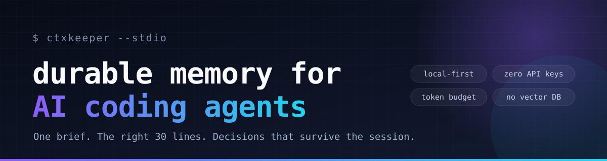

<p align="center">
  
</p>

<h1 align="center">ctxkeeper</h1>

<p align="center"><b>Your coding agent forgets everything between sessions. Fix that.</b></p>

<p align="center">
  <a href="https://github.com/Coisini-cyber/ctxkeeper-mcp/actions/workflows/ci.yml"></a>
  <a href="LICENSE"></a>
  = 20.11" src="https://img.shields.io/badge/node-%3E%3D20.11-brightgreen">
  
</p>

<p align="center"><a href="https://coisini-cyber.github.io/ctxkeeper-mcp/">Website</a> · English · <a href="README.zh-CN.md">简体中文</a></p>

---

**ctxkeeper** is a local-first [MCP](https://modelcontextprotocol.io) server that gives AI coding agents **durable project memory** and **token-budgeted context packs**.

No API keys. No vector database. No telemetry. One `node` process, one append-only file.

```text
Agent → project_brief
        ← stack · run/test commands · files to read first · git state
          open TODOs · decisions · gotchas · recent work        ~1.2k tokens

Agent → context_pack("where is the OAuth token refreshed?")
        ← src/auth/refresh.ts:42-78 + the decision that explains it  ~1.5k tokens

Agent → remember(type="gotcha", ...)   # survives the session
Agent → log_work(summary=..., next_steps=...)   # hands off to tomorrow
```

---

## The problem

Every new agent session starts cold:

- You re-explain the architecture, the constraints, and the command that actually runs the tests.
- The agent greps the repo, reads whole files, and burns thousands of tokens to find 30 lines.
- Decisions and gotchas live in yesterday's chat, not in the project.
- Switch from Claude Code to Cursor to OpenCode and all context is gone again.

Most MCP servers add **more tools**. `ctxkeeper` makes the tools you already have **need less context**.

---

## What you get

| Tool | R/W | What it does |
| --- | --- | --- |
| `project_brief` | read | Stack, commands, files to read first, git, TODOs, decisions, gotchas, recent work — one call |
| `context_pack` | read | Given a concrete question, returns only the relevant code windows (`path:line`) plus matching memories, under a token budget |
| `recall` | read | Keyword + CJK-aware search over saved memories, ranked by field, importance, and recency |
| `remember` | write | Persist a decision, gotcha, fact, command, todo, or note; identical entries are deduplicated |
| `todo` | write | Durable add / list / done / reopen across sessions |
| `forget` | write | Archive a memory; `restore=true` brings it back |
| `log_work` | write | Timestamped work log: summary, files, commands, outcome, next steps |
| `status` | read | Detected root, store paths, counts, git state, limits |

Also exposed: resource `ctxkeeper://brief`, prompt `onboard`, and server `instructions` that describe the workflow at handshake time.

---

## Why another MCP server?

The ecosystem has plenty of connectors. The [2026 survey data](docs/research.md) shows ~47k active servers in the official registry, but the scarce layer is **context**:

| Layer | Examples | Supply |
| --- | --- | --- |
| L1 Connect | filesystem, GitHub, browser, databases, SaaS | saturated |
| L2 Operate | deploy, open PRs, update tickets | crowded |
| L3 Domain workflow | finance, legal, recruiting | scarce, data-gated |
| **L4 Context** | **remember the project, pick the right lines, budget tokens, hand off** | **underserved** |

`ctxkeeper` is deliberately L4. It does not replace your GitHub or Playwright server; it reduces how often the agent needs them.

Design choices that follow from that:

- **Append-only JSONL, not a database.** No native build, crash-tolerant, multi-client friendly, auditable, and `forget` is reversible.
- **Memory bridges language.** A Chinese question can retrieve English code: memories contribute file paths and identifiers (e.g. `refreshToken`) as bridge terms for window selection.
- **Code blocks are never cut in half.** Each file gets a budget; if it does not fit, use the single best window or skip it and say so.
- **Read-only by construction.** No arbitrary shell. The only subprocess is fixed-argument, read-only `git`.
- **Sensitive files never enter context.** `.env*`, keys, credentials, and common token shapes are skipped or redacted.

---

## Quick start

Requires **Node.js >= 20.11**.

```bash
git clone https://github.com/Coisini-cyber/ctxkeeper-mcp.git
cd ctxkeeper-mcp
npm install          # also builds via the prepare script
npm test             # 11 end-to-end tests over real stdio
npm run demo -- . "how does the store work"
```

`demo` prints `status`, `project_brief`, and one `context_pack`, so you can judge the output quality before wiring it into a client.

No clone? Point your MCP client at the repository directly (it builds on first run):

```bash
npx -y github:Coisini-cyber/ctxkeeper-mcp
```

Running that in a terminal will look like it hangs — it is a stdio server waiting for a client.

The same binary is also a small CLI, useful for checking output without an MCP client:

```bash
node dist/index.js --brief
node dist/index.js --pack "where is the token refreshed?"
node dist/index.js --doctor
```

---

## Connect to OpenCode

Add this to your **global** config, `~/.config/opencode/opencode.json` (on Windows: `C:\Users\<you>\.config\opencode\opencode.json`):

```json
{
  "$schema": "https://opencode.ai/config.json",
  "mcp": {
    "ctxkeeper": {
      "type": "local",
      "command": ["node", "/absolute/path/to/ctxkeeper-mcp/dist/index.js"],
      "enabled": true,
      "timeout": 20000
    }
  }
}
```

Do **not** set `cwd`: the server detects the project root from the workspace, so one entry works in every repository.

If you prefer not to clone, use `"command": ["npx", "-y", "github:Coisini-cyber/ctxkeeper-mcp"]`. It builds on first run and is slower to start; the local path is recommended for daily use.

Verify:

```bash
opencode mcp list
# ✓ ctxkeeper  connected
```

Tools appear as `ctxkeeper_project_brief`, `ctxkeeper_context_pack`, and so on.

For project-only setup, put the same `mcp` block in the repository's `opencode.json`.

### Any other MCP client

```json
{
  "mcpServers": {
    "ctxkeeper": {
      "command": "node",
      "args": ["/absolute/path/to/ctxkeeper-mcp/dist/index.js"]
    }
  }
}
```

---

## Make the agent actually use it

Different clients weight server instructions differently. Add a hard rule to your `AGENTS.md` / `CLAUDE.md`:

```markdown
## Project memory (ctxkeeper)
- At the start of every session, call `ctxkeeper_project_brief` before reading files or grepping.
- To locate code, call `ctxkeeper_context_pack` with a concrete question, then read only the cited `path:line` ranges.
- Save confirmed decisions and gotchas with `ctxkeeper_remember`; track multi-step work with `ctxkeeper_todo`.
- Before finishing, call `ctxkeeper_log_work` with what changed, files touched, and next steps.
- Never store secrets, tokens, or full source files in memories.
```

---

## A real `project_brief`

Abridged output from this repository after a day of work:

```text
# Project brief: ctxkeeper-mcp
D:\mcp\ctxkeeper · no git · 2026-11-02 13:44

stack: TypeScript 88% · JavaScript 12% · 17 files · ~2.9k LOC
read first: `src/index.ts`, `README.md`

## Commands
- build: `npm run build`
- test: `npm run test`
- demo: `npm run demo`

## Open TODOs (2)
- [m_mvzb4ptlyn1kf] **Add an incremental file index** — avoid a full scan on every pack
- [m_mvzb4pug8vf7k] **Compact the event log** — snapshot + tail after tens of thousands of events

## Decisions (4)
- [m_mvzb7yweonhbc] **Bridge Chinese questions to English code** — memories contribute file paths and identifiers
- [m_mvzb4psxlo7qq] **Read-only code access, skip sensitive files** — no arbitrary shell; redact high-confidence secrets
- [m_mvzb4ps1k9vm8] **Never truncate a code block mid-line** — fall back to the best window or skip

## Gotchas (1)
- [m_mvzb4prdcpo9j] **The user's home directory is a git repo** — never adopt home/temp as the project root

## Recent work
- 2026-11-02 [success] Shipped ctxkeeper: event-sourced memory, brief, context pack, 11 e2e tests
  · next: incremental index; event-log compaction; one-week field test
```

That is the entire onboarding for a new session.

---

## Measured on this repo

Small repo, Windows 11, Node 22.23 — a pipeline check, not a benchmark:

| Operation | Latency | Output |
| --- | --- | --- |
| `project_brief` (cache hit) | ~10 ms | 0.5–1.2k tokens |
| `context_pack` (17 files scanned) | ~8–10 ms | ~1.0k tokens, 2–4 cited windows |
| Reading `src/store.ts` directly | — | ~3.5–4k tokens |

The gap grows with file size: `context_pack` returns the 30 lines around the answer, not the 430-line file.

---

## How memory is stored

```text
project/
├─ src/
├─ package.json
└─ .ctxkeeper/            # created automatically
   ├─ .gitignore          # contains "*" — memories are not committed
   └─ events.jsonl        # append-only event log
```

Every write is an event: `memory.add`, `memory.archive`, `memory.unarchive`, `todo.set`, `worklog.add`. Reads replay the log. This avoids native dependencies, survives crashes, lets multiple clients append safely, and makes archiving and completion reversible.

Global memories (cross-project preferences) live in `~/.ctxkeeper/global/`.

---

## Security and privacy

- **No network calls.** No accounts, keys, telemetry, or cloud storage.
- **Read boundary:** only text files inside the detected project root; skip `node_modules`, `.git`, `dist`, `build`, `target`, virtualenvs, and similar.
- **Sensitive files:** `.env*`, `*.pem`, `*.key`, `id_rsa*`, `credentials`, `secrets.*` are excluded from code search.
- **Redaction:** private key blocks, `sk-…`, `ghp_…`, `AKIA…`, `xox…` are redacted from output.
- **No arbitrary execution.** The only subprocess is read-only `git` with fixed arguments.
- **Caveat:** the store is plain text. Do not save secrets. Treat repository content as untrusted data, not instructions.

See [SECURITY.md](SECURITY.md) for reporting.

---

## Configuration

| Environment variable | Default | Purpose |
| --- | --- | --- |
| `CTXKEEPER_ROOT` | auto-detected | Force the project root (absolute path) |
| `CTXKEEPER_DIR` | `<root>/.ctxkeeper` | Project memory directory |
| `CTXKEEPER_GLOBAL_DIR` | `~/.ctxkeeper/global` | Global memory directory |
| `CTXKEEPER_MAX_FILE_KB` | `300` | Max size of a file read into context |
| `CTXKEEPER_DISABLE_CODE_SEARCH` | unset | Set to `1` to expose memory tools only |

Root detection order: `CTXKEEPER_ROOT` → nearest `.ctxkeeper` or project manifest (`package.json`, `pyproject.toml`, `Cargo.toml`, `go.mod`, …) → nearest `.git` (home and temp directories are never adopted) → `cwd`.

---

## Limitations

- Retrieval is lexical (identifiers + CJK bigrams), not embeddings. Try different keywords if `recall` misses.
- Large repositories are capped at 6,000 files / 24 MB per scan.
- The event log does not compact itself yet.
- No team sync, encryption, or per-user permissions. Built for individuals and small teams.
- Memory quality depends on write quality: short titles, concrete content, file paths.

Roadmap: incremental index → event-log compaction → optional local embeddings with lexical fallback → “recently changed files → related memories” in the brief.

See [docs/alternatives.md](docs/alternatives.md) for an honest comparison with `AGENTS.md`, the official Memory server, mem0/Letta, Graphify/Serena, and Context7. See [docs/research.md](docs/research.md) for the full 2026 MCP landscape and why this layer is underserved.

---

## FAQ

**Does it work with Claude Code / Cursor / Windsurf?**
Any client that supports local stdio MCP servers can run it. The examples use OpenCode, but the server itself has no client-specific code.

**Does it replace `AGENTS.md` / `CLAUDE.md`?**
No. Those are static instructions you maintain by hand. `ctxkeeper` adds dynamic project state (decisions, gotchas, TODOs, recent work) and retrieves only the relevant parts.

**Does my code leave the machine?**
No. There are no network calls, no accounts, and no telemetry. Code excerpts are read locally and returned to the client you already use.

**Why not embeddings?**
v0.1 deliberately trades semantic recall for zero install friction and offline operation. Lexical retrieval plus identifier/CJK tokenization covers concrete questions; an optional local embedding backend is on the roadmap.

**Is the memory committed to git?**
No. `.ctxkeeper/.gitignore` contains `*`, so the store stays local by default. Delete that file if you want to commit curated memories.

**How large a repo can it handle?**
Scans are capped at 6,000 files / 24 MB per call. Small and medium repositories are fine; very large monorepos need the incremental index on the roadmap.

---

## Contributing

Issues and PRs are welcome. Start with [CONTRIBUTING.md](CONTRIBUTING.md). The invariants are: local-first, no native deps, read-only code access, token-aware output, reversible writes.

If `ctxkeeper` saves you a few thousand tokens today, **star the repo** — it helps other developers find it.

## License

MIT © 2026 Sixian Deng
