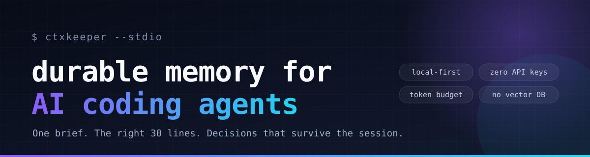

<p align="center">
  
</p>

<h1 align="center">ctxkeeper</h1>

<p align="center"><b>让 AI 编程 agent 拥有跨会话的项目记忆，并且只读该读的那 30 行。</b></p>

<p align="center">
  <a href="https://github.com/Coisini-cyber/ctxkeeper-mcp/actions/workflows/ci.yml"></a>
  <a href="LICENSE"></a>
  = 20.11" src="https://img.shields.io/badge/node-%3E%3D20.11-brightgreen">
  
</p>

<p align="center"><a href="https://coisini-cyber.github.io/ctxkeeper-mcp/">官网</a> · <a href="README.md">English</a> · 简体中文</p>

---

> 给 AI agent 的**项目长期记忆 + 上下文打包** MCP。本地优先、离线可用、无需 API Key。

`ctxkeeper` 解决的不是"agent 能不能读文件"，而是**每次新会话都要重新认识项目**：

- 昨天定下的架构决策，今天要重新解释一遍；
- 踩过的坑、跑测试的正确命令，散落在聊天记录里；
- agent 为了找一个函数，先 `grep` 再整文件读，几千 token 就没了；
- 换一个客户端（Claude Code / Cursor / OpenCode），上下文归零。

它把项目知识沉淀在仓库旁的 `.ctxkeeper/` 里，并提供 8 个工具：一次调用拿到项目简报，按问题精准打包代码片段，决策/坑/待办跨会话保留。

---

## 1. 它长什么样

```
project/
├─ src/
├─ package.json
└─ .ctxkeeper/            # 自动创建，自动 gitignore
   ├─ .gitignore          # 内容为 "*"，默认不提交
   └─ events.jsonl        # 追加式事件日志（决策、待办、工作日志）
```

一次典型的会话：

```text
Agent → project_brief()
        ← 技术栈 / 启动测试命令 / 先读哪些文件 / 未完成 TODO
          / 架构决策 / 已知坑 / 最近工作 / 目录结构        （约 1.2k tokens）

Agent → context_pack("token 刷新是在哪里做的？")
        ← src/auth/refresh.ts:42-78 等 3 段代码 + 相关决策  （约 1.5k tokens）

Agent → remember(type="gotcha", title="刷新必须提前 60s", ...)
Agent → log_work(summary="实现刷新端点", files=[...], next_steps=[...])
```

---

## 2. 为什么是它（调研结论）

2026 年的 MCP 生态并不缺 server：官方 Registry 已有约 **4.7 万个**活跃 server，GitHub 上 `mcp-server` 话题仓库超过 **3.8 万**。但供给结构高度集中：

| 已经过剩 | 仍然稀缺 |
| --- | --- |
| 文件系统、GitHub、浏览器、抓取、数据库、SaaS 官方连接器 | **跨会话的项目上下文**：决策、约束、坑、待办、工作交接 |
| 通用 RAG / 向量记忆（多数要外部服务或重配置） | **本地、零依赖、按 token 预算精准取上下文** |
| "能读整个仓库" | "只读该读的 30 行" |

`ctxkeeper` 刻意不做又一个 filesystem / GitHub server，而是减少它们的调用次数。完整调研、数据来源和竞品分析见 [`docs/research.md`](docs/research.md)，与 `AGENTS.md`、官方 Memory server、mem0/Letta、Graphify/Serena、Context7 的对比见 [`docs/alternatives.md`](docs/alternatives.md)。

---

## 3. 快速开始

要求：Node.js **>= 20.11**（开发时使用 22.23），Windows / macOS / Linux。

```bash
cd D:\mcp\ctxkeeper
npm install
npm run build
npm test          # 11 项端到端测试，真实 stdio 握手
npm run demo -- . "记忆是怎么排序的"
```

`demo` 会打印 `status`、`project_brief` 和一次 `context_pack`，用来确认安装和观察输出质量。

不想 clone 也可以直接在 MCP 客户端里指向仓库（首次运行会自动构建）：

```bash
npx -y github:Coisini-cyber/ctxkeeper-mcp
```

在终端直接运行会看起来像卡住——它是一个等待客户端连接的 stdio server。

同一个二进制也带一个轻量 CLI，方便不接客户端直接检查输出：

```bash
node dist/index.js --brief
node dist/index.js --pack "token 刷新在哪里做的？"
node dist/index.js --doctor
```

---

## 4. 接入 OpenCode

### 4.1 全局配置（推荐，一次配置所有项目）

编辑 `~/.config/opencode/opencode.json`（Windows 为 `C:\Users\<你>\.config\opencode\opencode.json`）：

```json
{
  "$schema": "https://opencode.ai/config.json",
  "mcp": {
    "ctxkeeper": {
      "type": "local",
      "command": ["node", "D:\\mcp\\ctxkeeper\\dist\\index.js"],
      "enabled": true,
      "timeout": 20000
    }
  }
}
```

**不要写 `cwd`**：server 会以当前工作区为起点自动探测项目根目录，因此同一个配置在所有仓库都能用。

如果不想 clone，可以用 `"command": ["npx", "-y", "github:Coisini-cyber/ctxkeeper-mcp"]`。首次启动会构建，速度较慢；日常使用仍推荐本地路径。

验证：

```bash
opencode mcp list
```

工具会以 `ctxkeeper_` 为前缀出现，例如 `ctxkeeper_project_brief`。

### 4.2 项目级配置

把同样的 `mcp` 段放进项目根目录的 `opencode.json` 即可。若只想让某个仓库启用，可加：

```json
{
  "mcp": {
    "ctxkeeper": {
      "type": "local",
      "command": ["node", "D:\\mcp\\ctxkeeper\\dist\\index.js"],
      "cwd": "."
    }
  }
}
```

### 4.3 让 agent 稳定使用（重要）

MCP server 会在握手时下发 `instructions`，但不同客户端对它的重视程度不同。建议在项目的 `AGENTS.md` / `CLAUDE.md` 里加一段硬约束：

```markdown
## 项目记忆（ctxkeeper）
- 每次会话开始，先调用 `ctxkeeper_project_brief`，不要先读文件或 grep。
- 需要定位代码时，先用 `ctxkeeper_context_pack` 提一个具体问题，只读返回的 path:line 片段。
- 用户确认的决策、踩过的坑，用 `ctxkeeper_remember` 保存；待办用 `ctxkeeper_todo`。
- 结束前用 `ctxkeeper_log_work` 记录：改了什么、动了哪些文件、下一步。
- 不要向记忆库写入密钥、令牌或完整源码。
```

### 4.4 其他客户端

任何支持 stdio MCP 的客户端都可以用，等价配置：

```json
{
  "mcpServers": {
    "ctxkeeper": {
      "command": "node",
      "args": ["D:\\mcp\\ctxkeeper\\dist\\index.js"]
    }
  }
}
```

---

## 5. 工具参考

| 工具 | 读写 | 作用 | 什么时候用 |
| --- | --- | --- | --- |
| `project_brief` | 只读 | 项目简报：栈、命令、先读文件、git、TODO、决策、坑、最近工作、结构 | **每个新会话第一步** |
| `context_pack` | 只读 | 按问题检索代码 + 记忆，返回带 `path:line` 的片段，受 token 预算约束 | 定位实现、排查问题、改代码前 |
| `recall` | 只读 | 关键词 / 中文二元组检索记忆，按标题、标签、文件、内容、重要度、时间排序 | 想知道"以前怎么定的" |
| `remember` | 写 | 保存 decision / gotcha / fact / command / todo / note；相同内容自动去重 | 用户拍板、发现非显然事实 |
| `todo` | 写 | add / list / done / reopen，跨会话保留 | 多步任务、交接 |
| `forget` | 写 | 归档记忆；`restore=true` 可恢复 | 决策被推翻、笔记有误 |
| `log_work` | 写 | 追加工作日志（摘要、文件、命令、结果、下一步） | 每次任务结束前 |
| `status` | 只读 | 根目录、存储路径、计数、git、扫描上限 | 排查"为什么没召回" |

另外还暴露：

- **Resource** `ctxkeeper://brief`：客户端可把项目简报作为资源挂载；
- **Prompt** `onboard`：一键让 agent 先读简报再汇报；
- **Server instructions**：握手时告知标准工作流。

### 参数要点

- `project_brief.budget_tokens`：默认 1200，范围 400–8000；超预算时优先丢弃目录树和近期日志。
- `context_pack.budget_tokens`：默认 1500，范围 300–12000；代码块不会被拦腰截断，放不下就换更短的窗口或跳过。
- `remember.scope`：`project` 只存当前仓库；`global` 存 `~/.ctxkeeper/global`，适合"回答一律用中文"这类跨项目偏好。
- `remember.replaces`：写入新决策时传旧 ID，旧记录自动归档，避免 brief 里出现互相矛盾的结论。

---

## 6. 实测

在本仓库（17 个源文件、约 2.9k LOC、Windows 11 / Node 22.23）上：

| 操作 | 耗时 | 输出 |
| --- | --- | --- |
| `project_brief`（缓存命中） | ~10 ms | 约 500–1200 tokens |
| `context_pack`（16 文件全扫） | ~8–10 ms | 约 1.0k tokens，2 个文件、4 段引用 |
| 端到端测试 | 11/11 通过 | 真实 stdio + 官方 SDK client |

对比：直接读 `src/store.ts`（430 行）约 3.5–4k tokens；`context_pack` 只返回命中的 2 段，约 1k tokens。仓库越大、文件越长，差距越明显。

> 数据只代表本机小仓库，不是基准测试。大仓库受 6000 文件 / 24 MB 扫描预算限制，见"限制"。

---

## 7. 数据、安全与隐私

**存储**

- 项目记忆：`<project>/.ctxkeeper/events.jsonl`（自动创建 `.gitignore`，默认不提交）
- 全局记忆：`~/.ctxkeeper/global/events.jsonl`
- 纯本地，**不发起任何网络请求**，不需要账号或 API Key。

**读取边界**

- 只扫描项目根目录以内，跳过 `node_modules`、`.git`、`dist`、`build`、`target`、`.venv` 等；
- 只读文本类扩展名，单文件默认上限 300 KB；
- 明确跳过 `.env*`、`*.pem`、`*.key`、`id_rsa*`、`credentials`、`secrets.*` 等敏感文件；
- 对 `sk-...`、`ghp_...`、`AKIA...`、私钥块等高置信度凭据做输出脱敏。

**执行边界**

- 不执行任意 shell；唯一的外部命令是只读 `git`（`rev-parse` / `status` / `log` / `remote`），通过 `execFile` 传固定参数；
- `forget` 是归档而非物理删除，可用 `restore=true` 撤销。

**仍然要注意**

- 记忆库是纯文本，**不要写入密钥、令牌、完整源码**；
- 代码片段可能包含恶意注释（提示注入），agent 应把工具输出当作数据而非指令；
- 多客户端并发写采用追加日志 + 按文件大小/mtime 重载，个人使用足够；不是数据库级事务。

---

## 8. 配置项

| 环境变量 | 默认 | 说明 |
| --- | --- | --- |
| `CTXKEEPER_ROOT` | 自动探测 | 强制项目根目录（绝对路径） |
| `CTXKEEPER_DIR` | `<root>/.ctxkeeper` | 项目记忆目录 |
| `CTXKEEPER_GLOBAL_DIR` | `~/.ctxkeeper/global` | 全局记忆目录 |
| `CTXKEEPER_MAX_FILE_KB` | `300` | 单文件读取上限 |
| `CTXKEEPER_DISABLE_CODE_SEARCH` | 未设置 | 设为 `1` 关闭 `context_pack` 的代码检索（只留记忆） |

**根目录探测顺序**：`CTXKEEPER_ROOT` → 从 cwd 向上找最近的 `.ctxkeeper` / 项目清单（`package.json`、`pyproject.toml`、`Cargo.toml`、`go.mod` 等）→ 最近的 `.git`（但不会把用户主目录或临时目录误当项目）→ 兜底 cwd。

---

## 9. 设计说明

**事件日志，而不是可变数据库。** 每条记忆/待办/日志都是一行 `{"v":1,"kind":"memory.add",...}`。读取时回放，写入时追加。好处：无需 native 依赖、崩溃不易损坏、多客户端只追加不覆盖、易于备份和审计。`forget` 和 `todo done` 也是事件，所以可恢复、可追溯。

**去重。** `remember` 对 `type + title + content` 做规范化 SHA-1；重复写入直接返回已有 ID，避免 agent 反复记同一件事。

**召回排序。** 英文按标识符拆分（camelCase / snake_case / kebab-case），中文按整段 + 二元组切分，不依赖分词词典。得分 = 标题×4 + 标签×3 + 文件×2.5 + 内容×1，再乘重要度与 45 天半衰期的时间衰减；查询词覆盖率过低会降权。

**上下文打包。** 先按路径和内容打分选文件，再在文件内找"覆盖查询词最多、命中密度最高"的窗口（而不是简单取前几处），小文件直接整篇返回。代码块整体放入，放不下就降级为最佳单窗口，绝不从中间截断代码。中文问题会先用召回记忆中的文件路径和英文标识符做"桥接"，再定位英文代码窗口。

**与 MCP 新规范的关系。** 2026-07-28 规范把 MCP 改为无状态、移除 `initialize` 会话。本项目本来就把状态放在文件而非连接里，方向一致；当前基于官方 TypeScript SDK 1.32.2（广泛部署的协议版本），后续可平滑迁移到新 SDK。

---

## 10. 限制与路线图

**已知限制**

- 检索是关键词/二元组，不是向量语义检索；换个说法可能召回不到，需要 `recall` 多试关键词。
- 大仓库扫描有上限（6000 文件 / 24 MB），超大 monorepo 可能漏文件；可用 `CTXKEEPER_MAX_FILE_KB` 调整，或后续加索引。
- 事件日志不自动压缩；几万条以后启动回放会变慢。
- 没有团队同步、加密、权限模型；定位是个人/小团队的本地工具。
- 记忆质量取决于写入质量：标题要短、内容要带"为什么"和文件路径。

**路线图**

1. 增量索引 + 文件指纹，避免每次全扫；
2. 事件日志压缩（snapshot + 尾部增量）；
3. 可选的 embedding 后端（本地模型），保留关键词兜底；
4. `brief` 里加入"最近改动文件 → 相关记忆"的关联；
5. 导出/导入（JSON），方便换机与团队共享脱敏知识。

---

## 11. 目录

```
ctxkeeper/
├─ src/
│  ├─ index.ts       # stdio server、instructions、resource、prompt
│  ├─ tools.ts       # 8 个工具的定义与处理
│  ├─ store.ts       # 事件日志、回放、去重、召回排序
│  ├─ scan.ts        # 项目扫描、清单解析、git、缓存
│  ├─ brief.ts       # token 预算内的项目简报
│  ├─ pack.ts        # 代码检索、窗口选择、上下文打包
│  ├─ fs-util.ts     # 忽略规则、敏感文件、文本文件遍历
│  ├─ text.ts        # 中英文分词、评分、截断、脱敏
│  └─ paths.ts       # 根目录探测、配置
├─ tests/e2e.test.mjs
├─ scripts/demo.mjs
└─ dist/             # npm run build 产物
```

---

## 12. 一句话总结

**把"每次重新认识项目"变成"一次记住、按需取用、结束交接"。**

如果它只帮你省掉每天第一次会话的 10 分钟和几万 token，就已经回本了。

---

如果这个项目对你有帮助，欢迎点一个 **Star**，让更多被"每次重新解释项目"折磨的开发者看到它。

