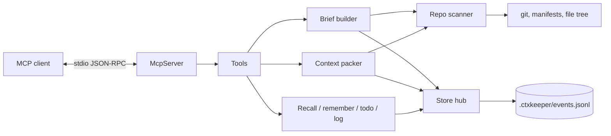

# Architecture

`ctxkeeper` is deliberately small: one Node process, one append-only file, no
services. This document explains how the pieces fit and where to change them.



## Components

| File | Responsibility |
| --- | --- |
| `src/index.ts` | stdio transport, server instructions, resource, prompt, CLI dispatch |
| `src/tools.ts` | the 8 MCP tools and their input schemas |
| `src/store.ts` | event log, replay, dedupe, recall scoring |
| `src/scan.ts` | project root scan, manifest parsing, git state, 30s cache |
| `src/brief.ts` | token-budgeted project brief |
| `src/pack.ts` | file selection, window extraction, memory-to-code bridge |
| `src/fs-util.ts` | ignore rules, sensitive-file exclusions, text walk |
| `src/text.ts` | tokenization, scoring, truncation, redaction |
| `src/cli.ts` | `--brief`, `--pack`, `--doctor` |
| `src/status.ts` | shared diagnostics for the tool and CLI |

## Event-sourced memory

Every write is a JSON line:

```json
{"v":1,"ts":"2026-11-02T13:41:00.000Z","kind":"memory.add","data":{"id":"m_...","type":"decision",...}}
```

Kinds: `memory.add`, `memory.archive`, `memory.unarchive`, `todo.set`,
`worklog.add`. Reads replay the log into an in-memory map. `forget` and
`todo done` are events too, which is why they are reversible.

Why not SQLite:

- no native build step on Windows/macOS/Linux;
- a partial write damages at most one line, which is skipped;
- multiple clients can append without read-modify-write conflicts;
- the log is trivially auditable and exportable.

The cost: the log grows forever and is fully replayed on startup. Compaction is
tracked in issue #2.

### Concurrency

Each operation calls `init()`, which stats the file and reloads only when size or
mtime changed. Appends are a single `appendFileSync` call. This is best-effort
for a handful of local clients, not a database transaction.

## Brief pipeline

1. `scanRepoCached` walks the repo (capped at 20k files), detects languages and
   manifests, reads `package.json` scripts / Makefile targets, and asks git for
   branch, dirty count, and recent commits.
2. The builder selects active memories by type (todos, decisions, gotchas, notes).
3. Sections are rendered in priority order and re-rendered with shorter detail if
   the budget is exceeded; structure and recent work are dropped first.
4. The footer tells the agent the next call to make.

## Context pack pipeline

1. Tokenize the question (English identifiers + CJK bigrams), with light stemming.
2. Recall memories; use their `files` and ASCII identifiers as **bridge terms**.
3. Score files by path and content, plus a boost for files cited by memories.
4. Read up to 6,000 files / 24 MB, skipping binaries, ignored dirs, and secrets.
5. Within each file, rank windows by distinct query-term coverage and hit density;
   never cut a code block in half.
6. Allocate the budget per file (`codeBudget / min(files, 3)`), fall back to the
   best single window, or skip the file and report it as omitted.
7. Redact high-confidence credential shapes in the final text.

## Security boundaries

- File reads are rooted at the detected project root.
- `.env*`, keys, `id_rsa*`, `credentials`, and `secrets.*` never enter code search.
- No arbitrary shell; the only subprocess is read-only `git` with fixed arguments.
- No network calls, telemetry, or remote storage.
- The store is plain text: do not write secrets into it.

## Extension points

- **New language/framework detection** → `FRAMEWORK_MAP` and `parse*` in `scan.ts`.
- **Better retrieval** → `tokenize`/`expandTerms` in `text.ts`, scoring in `pack.ts`.
- **New memory type** → `MemoryType` in `types.ts`, the tool enum, and brief sections.
- **Incremental index** → replace `listProjectFiles` + read loop with a cached index.
- **Embeddings** → add a local backend behind `packContext`, keep lexical fallback.

## Testing

`tests/e2e.test.mjs` spawns the built server over stdio with the official SDK
client and exercises memory, TODO lifecycle, CJK retrieval, `.env` exclusion,
archive/restore, resources, and CLI commands. CI runs the same suite on Node 20
and 22.
